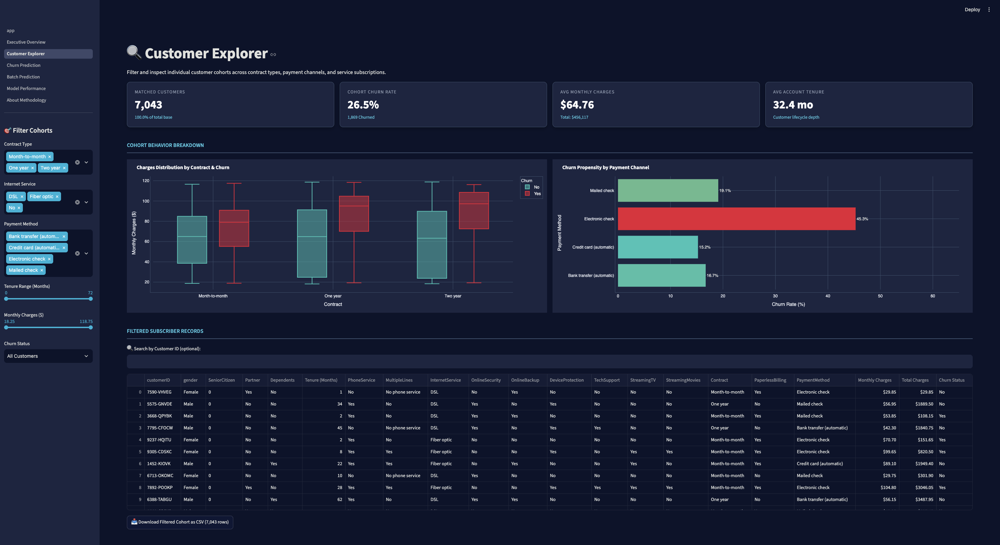
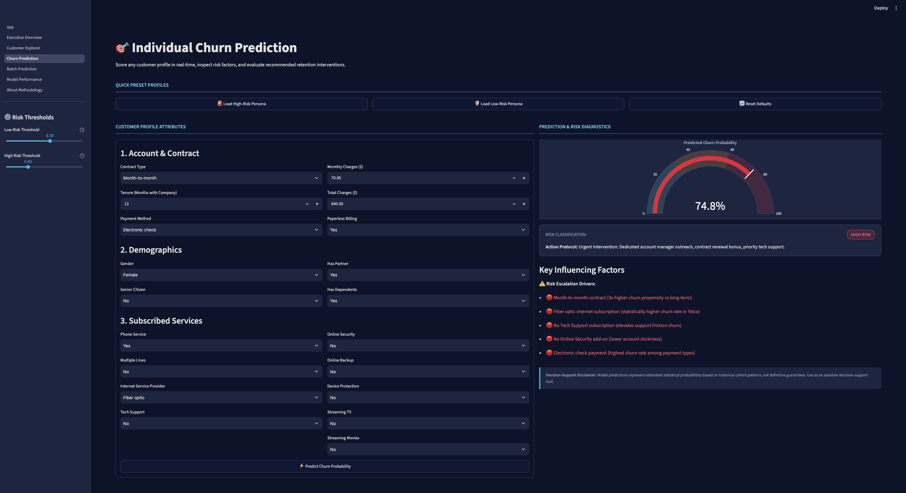
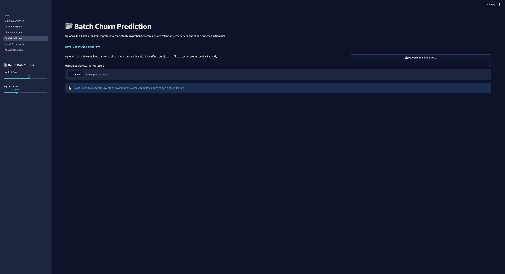
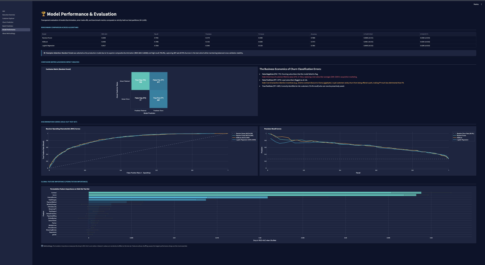
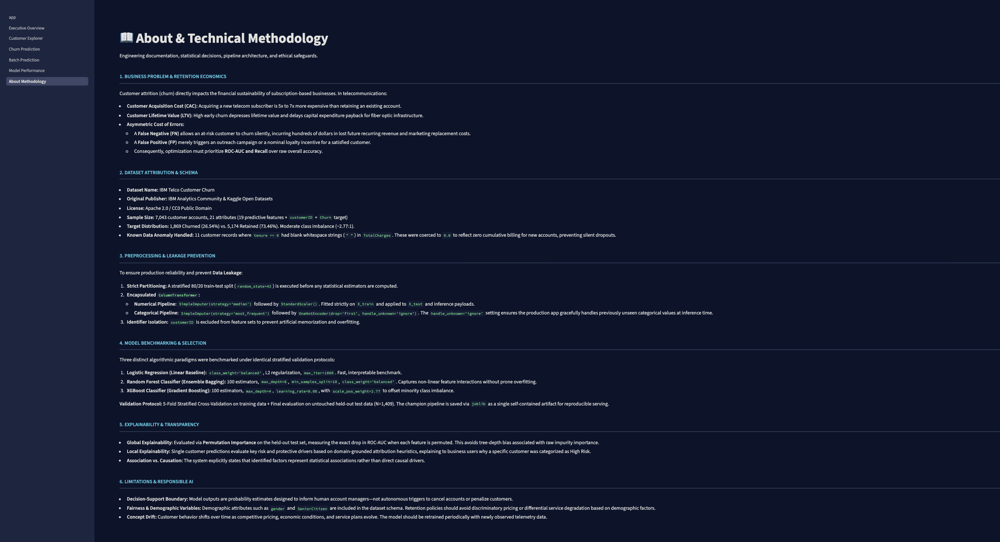
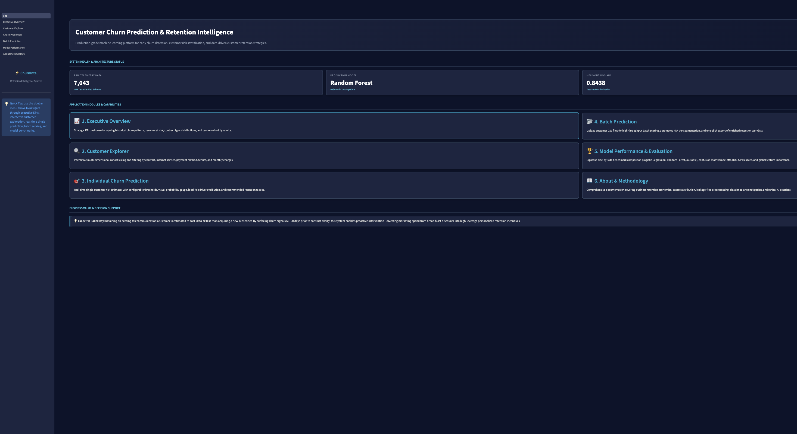

# ⚡ Customer Churn Prediction & Retention Intelligence Dashboard

[](https://www.python.org/)
[](https://scikit-learn.org/)
[](https://streamlit.io/)
[](https://plotly.com/python/)
[](LICENSE)

An interactive machine learning application for exploring customer churn patterns, estimating churn probability, scoring customer batches, and presenting model evaluation results in a Streamlit dashboard.

> **Project focus:** Machine Learning · Classification · Feature Engineering · Model Evaluation · Explainability · Streamlit

---

## 📌 Table of Contents

- [Project Overview](#-project-overview)
- [Dashboard Screenshots](#-dashboard-screenshots)
- [Key Features](#-key-features)
- [Dataset](#-dataset)
- [Machine Learning Workflow](#-machine-learning-workflow)
- [Model Results](#-model-results)
- [Technology Stack](#-technology-stack)
- [Project Structure](#-project-structure)
- [Getting Started](#-getting-started)
- [Run the Application](#-run-the-application)
- [Run Tests](#-run-tests)
- [Limitations and Responsible Use](#-limitations-and-responsible-use)
- [Future Improvements](#-future-improvements)
- [License](#-license)

---

## 🌟 Project Overview

Customer churn occurs when a customer stops using a company's product or service. Understanding which customers are more likely to leave can help teams investigate customer experience issues and plan retention activities.

This project uses the **IBM Telco Customer Churn dataset** to build a classification workflow and a multi-page dashboard. Users can explore historical patterns, submit a customer profile for a churn-risk estimate, upload a CSV for batch scoring, and inspect model performance.

The model's predictions are estimates based on historical data. They should support human review rather than be treated as guaranteed outcomes.

## 📸 Dashboard Screenshots

The screenshots below are stored in `docs/screenshots/`. Select an image to open it at full size on GitHub.

### Executive Overview


### Customer Explorer


### Individual Churn Prediction


### Batch Prediction


### Model Performance


### About and Methodology


### Application Landing Page


---

## ✨ Key Features

- **Executive overview:** KPI cards and visual summaries of customer churn and subscription patterns.
- **Customer explorer:** Filter and inspect customer records using available customer attributes.
- **Individual prediction:** Submit a customer profile to obtain a predicted churn class and probability.
- **Batch prediction:** Upload a CSV, validate the input, score multiple customers, and download the results.
- **Model evaluation:** Review classification metrics, a confusion matrix, model comparisons, and feature-importance visualizations where available.
- **Methodology page:** Review the dataset, preprocessing approach, model workflow, and responsible-use considerations.
- **Reusable ML pipeline:** Keep preprocessing and classification together in a saved scikit-learn pipeline.

## 🗂️ Dataset

This project uses the **IBM Telco Customer Churn** dataset, containing **7,043 customer records** and customer account, service, billing, and churn information.

- **Target:** `Churn` (`Yes` / `No`)
- **Rows:** 7,043
- **Features:** Customer tenure, contract type, services, payment method, monthly charges, total charges, and other available fields.
- **Source:** [IBM community](https://community.ibm.com/) and the publicly distributed Telco Customer Churn dataset.

The dataset represents a particular historical customer cohort. Results on this dataset may not generalize to another company, time period, or customer population without further validation.

## 🔬 Machine Learning Workflow

1. **Load and validate data** — read the source CSV and check expected fields.
2. **Clean data** — coerce numeric fields and handle blank or malformed values.
3. **Split the data** — use a stratified train/test split so the target proportions are represented in each partition.
4. **Preprocess features** — use a scikit-learn `ColumnTransformer` to handle numerical and categorical columns.
5. **Train and compare models** — compare Logistic Regression, Random Forest, and XGBoost when configured and available in the project environment.
6. **Evaluate performance** — measure metrics on a held-out test set and use cross-validation for model comparison.
7. **Save the selected pipeline** — serialize the preprocessing and model together for inference.
8. **Serve predictions** — use the Streamlit pages for individual and batch scoring.

### Preprocessing details

- Numerical fields can use imputation and scaling.
- Categorical fields can use imputation and one-hot encoding.
- Unknown categories should be handled by the encoder configuration rather than causing an inference failure.
- Fit preprocessing only on training data to reduce data leakage.

## 📈 Model Results

The project's recorded held-out test results for the selected **Random Forest** pipeline are:

| Metric | Recorded result |
|---|---:|
| ROC-AUC | **0.8438** |
| Recall | **0.7941** |
| Precision | **0.5174** |
| F1-score | **0.6266** |
| Accuracy | **0.7488** |
| Test examples | **1,409** |

Recorded confusion-matrix counts:

| | Predicted retained | Predicted churn |
|---|---:|---:|
| **Actually retained** | 758 | 277 |
| **Actually churned** | 77 | 297 |

**How to interpret these results:** Recall measures the share of actual churn cases detected by the model. Precision measures how many customers flagged as churn risks actually churned in the test set. ROC-AUC measures how well the model ranks positive cases above negative cases across thresholds.

These numbers are the project's recorded results; rerun the evaluation workflow to reproduce them in your environment. Performance can change with data, dependencies, preprocessing, model settings, or decision threshold.

## 🧰 Technology Stack

- **Language:** Python
- **Data processing:** Pandas, NumPy
- **Machine learning:** scikit-learn; XGBoost if installed and enabled
- **Model persistence:** Joblib
- **Dashboard:** Streamlit
- **Visualizations:** Plotly
- **Testing and linting:** Pytest, Ruff

## 📁 Project Structure

```text
Customer-Churn-Prediction/
├── app.py
├── pages/
│   ├── 1_Executive_Overview.py
│   ├── 2_Customer_Explorer.py
│   ├── 3_Churn_Prediction.py
│   ├── 4_Batch_Prediction.py
│   ├── 5_Model_Performance.py
│   └── 6_About_Methodology.py
├── src/
│   ├── data_loader.py
│   ├── preprocessing.py
│   ├── train.py
│   ├── evaluate.py
│   ├── predict.py
│   ├── explainability.py
│   └── ui_utils.py
├── data/
│   ├── raw/
│   └── processed/
├── models/
├── reports/
├── docs/
│   └── screenshots/
│       ├── home.png
│       ├── executive-overview.png
│       ├── customer-explorer.png
│       ├── churn-prediction.png
│       ├── batch-prediction.png
│       ├── model-performance.png
│       └── methodology.png
├── tests/
├── .streamlit/
├── requirements.txt
├── pyproject.toml
├── .gitignore
├── LICENSE
└── README.md
```

*This is a high-level structure; files may differ slightly depending on the current version of the repository.*

## ⚙️ Getting Started

### Prerequisites

- Python 3.11 recommended
- Git
- A terminal and a supported browser

### 1. Clone the repository

Replace the URL below with the actual public repository URL if you fork or rename the project.

```bash
git clone https://github.com/ramritheesh/Customer-Churn-Prediction.git
cd Customer-Churn-Prediction
```

### 2. Create and activate a virtual environment

**macOS / Linux**

```bash
python3.11 -m venv .venv
source .venv/bin/activate
```

**Windows PowerShell**

```powershell
python -m venv .venv
.venv\Scripts\Activate.ps1
```

### 3. Install dependencies

```bash
python -m pip install --upgrade pip
pip install -r requirements.txt
```

Use the dependency versions specified by the repository. If loading a saved Joblib/scikit-learn model raises a version warning, use a compatible environment or retrain and save the model using the environment's installed versions.

## ▶️ Run the Application

From the project root, with the virtual environment activated:

```bash
streamlit run app.py
```

Open the local URL printed by Streamlit, typically:

```text
http://localhost:8501
```

## 🧪 Run Tests

Run the test suite:

```bash
pytest -v tests/
```

If Ruff is configured in the project, run:

```bash
ruff check .
```

## ⚖️ Limitations and Responsible Use

- **Correlation is not causation:** patterns associated with churn do not prove that a particular intervention will prevent it.
- **Historical data:** the dataset is a fixed historical sample and may not represent current customer behavior.
- **Prediction uncertainty:** a predicted probability is not a guarantee that a customer will churn.
- **Fairness:** evaluate model performance across relevant customer groups before operational use.
- **Human oversight:** use predictions to prioritize review and support, not to make punitive or automatic service decisions.
- **Production readiness:** real deployment requires current data, monitoring, privacy/security controls, validation, and periodic model review.

## 🚀 Future Improvements

- Deploy the dashboard to Streamlit Community Cloud.
- Add drift and data-quality monitoring.
- Calibrate probabilities and tune the decision threshold against explicit business costs.
- Add explainability visualizations and validate local explanations.
- Evaluate retention interventions through controlled experiments.
- Add automated CI checks for tests and code quality.

## 📄 License

This project is distributed under the [MIT License](LICENSE). See the `LICENSE` file for the full terms.
